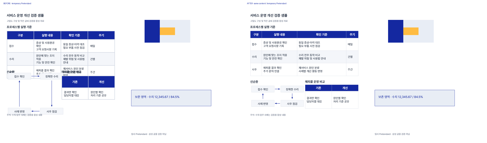
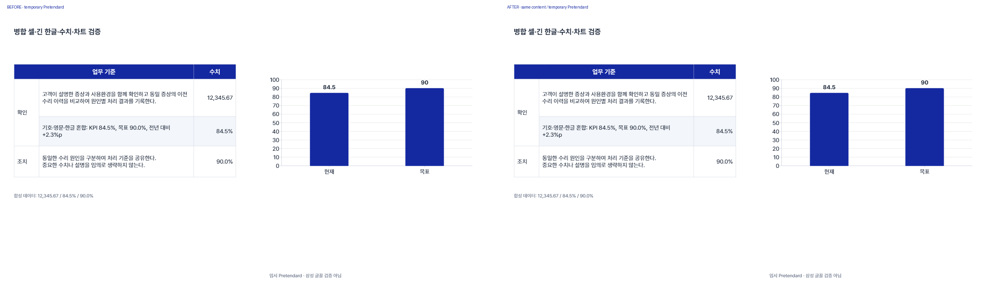

# Slide Master work order and quality comparison — 2026-11-07

Continues [PR #14](https://github.com/FriendY0421/slide-master/pull/14),
[ChatGPT/DOTS handoff](CHATGPT_DOTS_HANDOFF.md) and the
[primary-source resource review](PPT_RESOURCE_REVIEW_20261107.md).
FAH integration is deferred. Existing company assets, source/recovery copies,
template/CUSTOM approval parts and production owners are preserved.

Subsequent operational checkpoint: the user approved required dependencies and
limited rollback; [0.4.4 was applied and verified on desktop/cloud](PLUGIN_044_APPLIED_20261107.md).
The source-only statements below describe this earlier engineering checkpoint;
the linked operational record is current. Main remains unmerged.

## Overall order, including this change

| Order | Work | Evidence/status and next dependency |
| --- | --- | --- |
| 1 | Establish exact source/plugin identity, originals and recovery | Existing main plugin 0.4.3 source/readback and backup evidence retained; PR branch is separate from installed release/main. |
| 2 | Basic/custom route, real template preview and bundled brief | Existing Picker/CUSTOM/request-state components reused. Registered Picker transport/auth scope and PC-off availability remain unresolved; no replacement created. |
| 3 | Actual attachment analysis and current outline approval | Workflow exists, but genuine new-photo attachment acceptance is still awaiting a real user attachment. Do not reuse the public-reference success as attachment proof. |
| 4 | Detailed editable production: fonts, tables, diagrams, images | Existing converter, native tables/charts and opt-in spacing/dense contracts retained. Earlier reflow/actual PowerPoint evidence remains historical; Samsung/company acceptance is not closed. |
| 5 | Preserve original text/numbers/merges and protected content | **Implemented in this PR:** opt-in pinned-reference comparison, grouped-child/table-cell traversal, protected XML and dependency/relationship checks. Existing final verifier executes it. |
| 6 | Track findings through repair and report real coverage | **Implemented and exercised:** same-contract baseline/final measurements, resolved/remaining/new/unverified findings; partial coverage stays explicit. This does not automatically redesign slides. |
| 7 | Same-fixture export, reimport/render and visual comparison | **Completed for this engineering fixture:** two-slide before/after copies, 38 measured regions each, old reflow reused, right-half pixel preservation. Target-app editing of these new bytes is not tested. |
| 8 | Optional independent photo OCR/table-coordinate cross-check | **Deferred, not installed.** Start with the existing host model's real-pixel analysis when a user photo arrives. Consider PaddleOCR only if that trial shows a measured transcription bottleneck. |
| 9 | Real attachment → confirmation → production → private delivery → recipient opening | Existing cloud public-reference/resume route passed. Full new-user attachment, isolated main-plugin invocation and recipient-direct opening remain separate acceptance. |
| 10 | Operational rollout and PC-independent use | This change is source/PR only. Do not claim live plugin uptake, main merge or cloud deployment. Bundle exact release/permissions/cost/retention/rollback before new setup. Windows PowerPoint remains distinct from cloud rendering. |

## Actual implementation and compatibility

The new standard-library helper `pptx_reference_quality.py` is called by the
existing `dense_pptx_quality.inspect_pptx()` only when `reference_comparison` is
declared. `verify_deck.py` already calls that inspector and now surfaces partial
reference coverage. [Contract and runbook](REFERENCE_QUALITY.md).

Actual compatibility check: on the same final fixture and a contract without the
new block, the new inspector report equals the pre-change inspector report in
full, not just its error count. No third-party generator, evaluator source or
model was vendored. No global font, template or slide-count rule was changed.

One fault probe exposed a real implementation gap: comparing only reachable
dependency bytes could miss a changed slide-layout relationship because both
layouts reached the same master/layout set. The helper now also compares graph
edges and slide-level context; the changed-layout probe is rejected.

## Identical high-density content, before and after

Reused the original engineering fixture's before/reflow source and existing
mixed-table/chart slide through the existing SVG-to-native converter. Both decks
use the same temporary OFL Pretendard, wording and numbers. They contain three
native tables (including merged cells), a native chart/workbook, one editable
image, one native group, 14/12/11/9pt roles, long Korean, decimals/percentages,
boxes and four directional arrows. Added the same synthetic right-side protected
image/group to both versions, never a company asset. No automatic font shrinking.

**Attribution of improvement:** the 8→0 geometry improvement reuses the earlier
reflow; it is not a newly invented layout benefit of the comparison helper.
The new contribution is catching preservation regressions and linking actual
before/after findings, with explicit unsupported coverage.

| Evidence | Before | After |
| --- | --- | --- |
| Measured regions, same contract/font bytes | 38 | 38 |
| Mechanical geometry errors | 8 | 0 |
| Findings tracked | 8 occurrences across 7 target/kind records | All 8 absent in final mechanical measurements |
| Reference preservation checks | 94 | 94, no failures |
| Native text/table/merge preservation | Baseline | Unchanged |
| Right-half rendered pixels, both slides | Baseline | Exactly identical |
| Entire slide 2 rendered pixels | Baseline | Exactly identical |
| Process-checked reopened render | 2 pages, OS exit 0 | 2 pages, OS exit 0 |
| Reference status | Partial | Partial: native chart text/data needs dedicated checks |
| Actual Microsoft PowerPoint edit/save/reopen of these bytes | Not performed | Not performed |

First slide comparison (view the full image for small text):

Second slide includes long Korean, merged cells, numeric values and a native chart:

[Before editable engineering PPTX](evidence/reference-quality-20261107/before.pptx)
and [after editable engineering PPTX](evidence/reference-quality-20261107/after.pptx).
These are public synthetic validation files, not company material or production
templates. Their encoded Pretendard selection/process-local rendering does not
verify Samsung or PowerPoint font rendering on a recipient's machine.

## Fault-injection and final-route evidence

Ten altered copies were rejected: table number, group text, protected group
position, embedded image bytes, chart data, master, slide background, slide-layout
relationship target, merge topology and missing table. The previous geometry-only
inspector reported zero errors for the first eight; the new comparison rejects
all ten. The last two were already partly caught; the new layer adds source
preservation evidence. Wrong baseline hash and strict unsupported coverage also
reject. A deleted table does not falsely count as a repaired height error.

Existing `verify_deck.py` ran the dense comparison and the supplied process-checked
renderer on the two-slide engineering project, returning exit 0 with warnings.
The first attempt failed because the copied legacy engineering scaffold lacked
its explicit flat structure lock. The existing fixture's truthful flat lock was
restored and the full command passed; no approval record or content gate was
fabricated. Project metadata/design-plan warnings remain, as this is an engine
fixture, not a planned company presentation. Partial chart coverage is also a
warning. Do not describe this as strict production acceptance. OfficeCLI was not
installed for this work; no new native-app validation is inferred from gate exit 0.

All four before/after rendered pages were compared; the current model visually
inspected the changed first slide and final mixed slide at full resolution.
Exact final-file reimport and render are verified. Original Samsung fixtures
were not rerendered; no Samsung font file was loaded, registered or embedded.

Public [sanitized evidence](evidence/reference-quality-20261107/summary.json)
records actual output/page hashes and fault results without private machine paths.

## Cost, permission, application and recovery

- This work used existing local Python/Pillow/Node/Artifact Tool and bundled OFL
  Pretendard. No separately billed API, server, GPU service or HF inference was
  activated; no company photo/font was uploaded to any public demo.
- No install, new auth/permission, font OS registration/embedding, plugin release,
  cloud deployment, main merge or FAH integration occurred. Existing installed
  0.4.3 does **not** contain this new helper simply because PR code was pushed.
- If optional OCR is needed later, first present the exact CPU environment and
  pinned model/version/download footprint, install target, data path/retention,
  resource/cost impact and cleanup plan together. Prefer the existing host's
  capabilities; do not request blanket permission for unknown setup.
- Production rollout would need the helper **and** updated inspector/instructions
  together. Read the then-current exact plugin source/release before packaging;
  preserve existing identity/audience/dependencies and prepare guarded recovery.
- Existing originals, earlier results and private engineering copies remain.
  To disable this opt-in check for an approved task, remove its reference block;
  default inspector behavior is unchanged. Do not disable a required preservation
  contract to conceal a failure. Source rollback should revert the eventual
  quality-change commit normally; no reset/force-push or original deletion.

Remaining user-dependent conditions: an actual authorized photo, its current
outline approval, recipient-direct opening, company-original source and separate
Samsung usage rights. These remain outside the completed code/sample checks.
